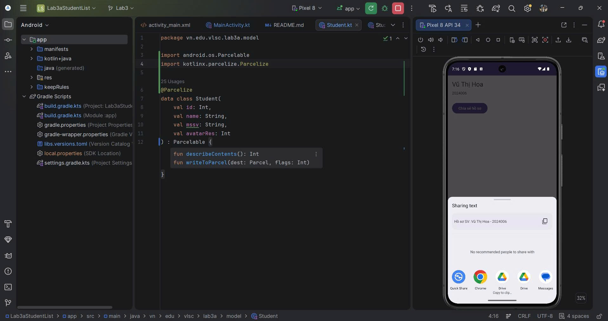

# Lab 04 - Điều Hướng Đa Màn Hình Với Intent & Vòng Đời Activity

Báo cáo bài thực hành **Lab 04 (Lab 3b)** - Phát triển ứng dụng di động (Mobile App) tích hợp AI | Dành cho Sinh viên VLSC.

---

## 📸 Hình Ảnh Minh Chứng Thực Tế

---

## 🎯 Nội Dung Trọng Tâm & Kiến Trúc


### 1. Kiến Trúc Activity Lifecycle & IPC Binder
- **Explicit Intent**: Định tuyến trực tiếp từ `MainActivity` sang `DetailActivity` với độ phức tạp $O(1)$, ghép nối chặt chẽ và truyền gói dữ liệu nội bộ.
- **Implicit Intent**: Kích hoạt `Intent.ACTION_SEND` qua `Intent.createChooser` giúp người dùng chia sẻ thông tin sinh viên sang ứng dụng bên thứ 3 (Gmail, Zalo, Messages, Copy to Clipboard,...).
- **Giao Thức Parcelable**: Tái cấu trúc Data Model `Student` sử dụng `@Parcelize` (`kotlin-parcelize`) giúp tự động sinh mã tuần tự hóa tại thời điểm biên dịch, tối ưu tốc độ so với reflection của `Serializable`.

### 2. Định Tuyến & Giải Nén Dữ Liệu Tương Thích API
- **Khởi tạo Intent tại `MainActivity`**:
  ```kotlin
  private val studentAdapter = StudentAdapter { student ->
      val intent = Intent(this@MainActivity, DetailActivity::class.java).apply {
          putExtra(DetailActivity.EXTRA_STUDENT, student)
      }
      startActivity(intent)
  }
  ```

- **Giải nén Payload an toàn tại `DetailActivity`** (Hỗ trợ API 33+ Tiramisu & Null-Safety):
  ```kotlin
  val student: Student? = if (Build.VERSION.SDK_INT >= Build.VERSION_CODES.TIRAMISU) {
      intent.getParcelableExtra(EXTRA_STUDENT, Student::class.java)
  } else {
      @Suppress("DEPRECATION")
      intent.getParcelableExtra(EXTRA_STUDENT)
  }

  student?.let { sv ->
      binding.tvDetailName.text = sv.name
      binding.tvDetailMssv.text = sv.mssv
  } ?: run {
      binding.tvDetailName.text = "Lỗi: Khuyết dữ liệu định tuyến."
      binding.btnShare.isEnabled = false
  }
  ```

---

## 🐛 Báo Cáo Bắt Lỗi & Huấn Luyện Gỡ Lỗi (Intentional Bugs)

### 🔴 Lỗi 1: Tràn bộ đệm Binder (`TransactionTooLargeException`)
- **Thử nghiệm**: Tiêm gói dữ liệu lớn vào Bundle:
  ```kotlin
  intent.putExtra("CRASH", ByteArray(1024 * 1024 + 512 * 1024)) // ~1.5MB
  ```
- **Hiện tượng hệ thống**: Ứng dụng đóng đột ngột. Hệ thống Android giới hạn dung lượng bộ đệm Binder IPC ở mức **~1MB**, khi vượt quá sẽ ném ngoại lệ `android.os.TransactionTooLargeException`.
- **Giải pháp khắc phục**: Khống chế dung lượng Bundle dưới 500KB. Chỉ truyền các tham số định danh (ID) qua Intent, dữ liệu lớn cần được lưu trữ và truy xuất từ cơ sở dữ liệu nội địa (Room) hoặc Repository Pattern.

### 🔴 Lỗi 2: Trói buộc Context (Memory Leak)
- **Thử nghiệm**: Tiêm tham chiếu tĩnh (static context):
  ```kotlin
  companion object { var leakContext: Context? = null }
  // Trong onCreate():
  leakContext = this
  ```
  Thực hiện xoay màn hình thiết bị liên tục 5 lần để kích hoạt hủy và tạo lại Activity theo vòng đời (Lifecycle).
- **Hiện tượng hệ thống**: Khi Activity cũ bị hủy (`onDestroy`), Bộ thu gom rác (Garbage Collector) không thể xóa Activity ra khỏi bộ nhớ RAM do biến `leakContext` đang duy trì tham chiếu mạnh (strong reference).
- **Giải pháp khắc phục**: Gán `leakContext = null` bên trong callback `onDestroy()` hoặc thay thế tham chiếu Activity bằng `applicationContext`.

---

## 📂 Cấu Trúc Mã Nguồn Project

```text
vn.edu.vlsc.lab3a/
├── model/
│   └── Student.kt           # Data Model triển khai Parcelable
├── adapter/
│   └── StudentAdapter.kt    # ListAdapter + DiffUtil cho RecyclerView
├── MainActivity.kt          # Hiển thị danh sách & kích hoạt Explicit Intent
└── DetailActivity.kt        # Hiển thị chi tiết & kích hoạt Implicit Intent
```
