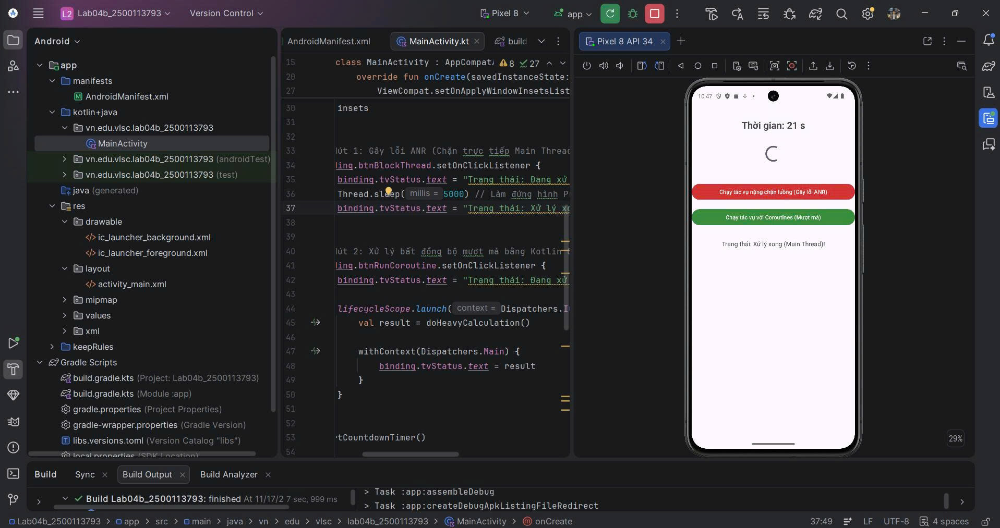
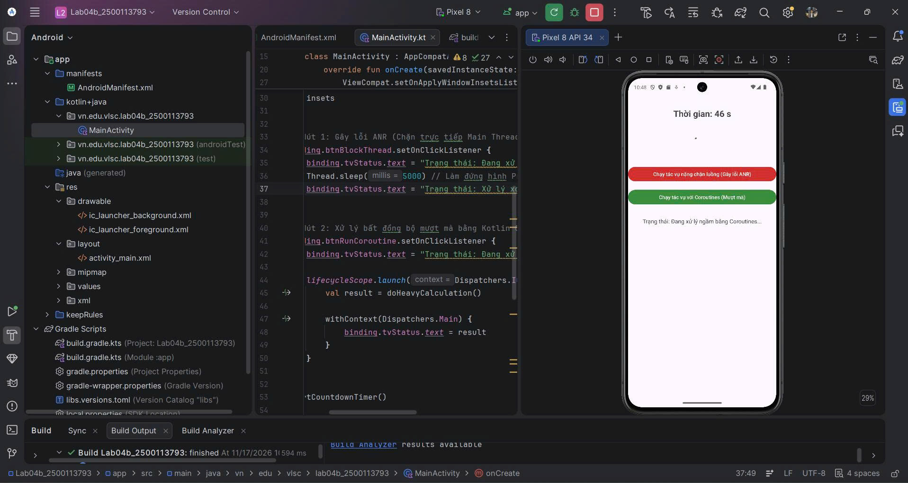

# Báo cáo Thực hành Lab 04b: Xử lý Đa luồng & Kotlin Coroutines trong Android

- **Tên dự án:** Lab04b_2500113793
- **Mã sinh viên:** 2500113793
- **Họ và tên:** Nguyễn Ngọc Tiến
- **Ngôn ngữ lập trình:** Kotlin
- **Công nghệ sử dụng:** Android SDK, View Binding, Kotlin Coroutines (`lifecycleScope`, `Dispatchers.IO`, `Dispatchers.Main`), ConstraintLayout.

---

## 🎯 Mục tiêu Bài Lab
1. **Tìm hiểu về ANR (Application Not Responding):** Thấy rõ tác hại của việc thực thi tác vụ tốn thời gian (Heavy operations / I/O) trực tiếp trên Main Thread (UI Thread), khiến ứng dụng bị đơ/treo và không thể tương tác.
2. **Ứng dụng Kotlin Coroutines:** Sử dụng Coroutine để chuyển tác vụ nặng sang luồng nền (`Dispatchers.IO`) và cập nhật kết quả về luồng giao diện (`Dispatchers.Main`) một cách mượt mà không chặn UI Thread.

---

## ⚙️ Các Chức năng Chính trong Ứng dụng
- ⏱️ **Đồng hồ đếm ngược (Countdown Timer):** Chạy tự động từ 60 giây về 1 giây trên Main Thread thông qua `lifecycleScope.launch` và `delay(1000)`. Đồng hồ này dùng làm thước đo kiểm tra độ mượt của UI.
- 🔄 **ProgressBar xoay liên tục:** Thể hiện trực quan ứng dụng có đang phản hồi hay bị đơ.
- 🔴 **Nút 1 - Gây đơ UI (Main Thread):** 
  - Gọi `Thread.sleep(5000)` trực tiếp trên Main Thread.
  - **Hiện tượng:** Đồng hồ đếm ngược ngừng chạy, ProgressBar đứng hình, người dùng không thể thao tác trong 5 giây (nguy cơ gây ra ANR).
- 🟢 **Nút 2 - Xử lý mượt mà (Kotlin Coroutines):** 
  - Chạy hàm tạm dừng `doHeavyCalculation()` với `lifecycleScope.launch(Dispatchers.IO)` và `delay(5000)`.
  - Cập nhật kết quả lên TextView bằng `withContext(Dispatchers.Main)`.
  - **Hiện tượng:** Đồng hồ đếm ngược vẫn chạy bình thường, ProgressBar vẫn xoay mượt mà trong khi tác vụ ngầm đang xử lý.

---

## 🖼️ Ảnh Minh chứng Kết quả (Screenshots)

### 1. Minh chứng khi bấm nút "Gây đơ UI (Main Thread)"
*Đồng hồ đếm ngược bị khựng/dừng lại, ProgressBar bị đứng hình không xoay trong 5 giây.*

![Minh chứng đơ giao diện Main Thread]

---

### 2. Minh chứng khi bấm nút "Xử lý với Coroutines (Mượt mà)"
*Tác vụ ngầm đang xử lý nhưng đồng hồ đếm ngược vẫn tiếp tục đếm, ProgressBar vẫn xoay mượt mà và hiển thị thông báo kết quả thành công.*

![Minh chứng xử lý mượt bằng Coroutines]

---

## 🛠️ Hướng dẫn Khởi chạy & Kiểm thử

1. Mở dự án trong **Android Studio**.
2. Kết nối thiết bị Android thật hoặc khởi động **Android Emulator**.
3. Nhấn **Run `app`** (`Shift + F10`) để cài đặt và chạy ứng dụng.
4. **Kịch bản kiểm thử:**
   - Quan sát đồng hồ đếm ngược và ProgressBar xoay mượt mà.
   - Nhấn nút màu đỏ **"Chạy tác vụ nặng chặn luồng (Gây lỗi ANR)"** ➡️ Quan sát thấy đồng hồ dừng và ProgressBar ngưng xoay trong 5s.
   - Nhấn nút màu xanh **"Chạy tác vụ với Coroutines (Mượt mà)"** ➡️ Quan sát thấy đồng hồ và ProgressBar vẫn hoạt động bình thường, sau 5s có thông báo xử lý xong.
