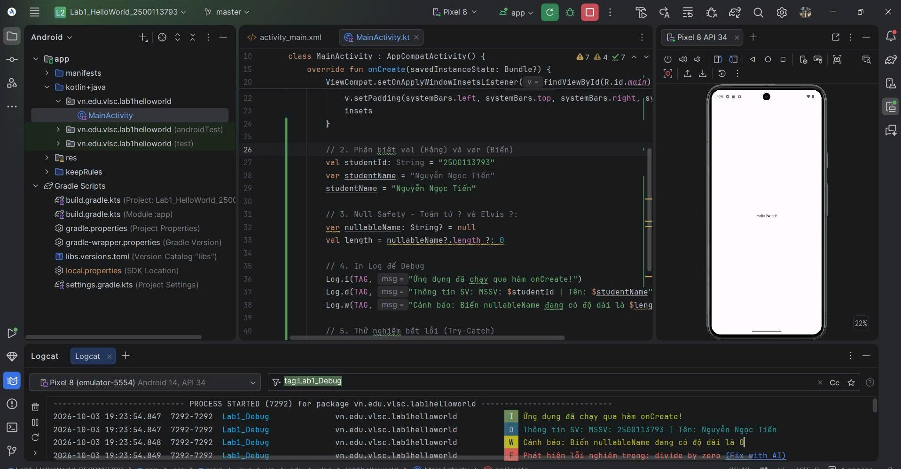

# Bài thực hành Lab 1 - Lập trình Android Cơ bản

## Thông tin sinh viên
- **Họ và tên:** Nguyễn Ngọc Tiến
- **Mã số sinh viên (MSSV):** 2500113793

## Kết quả thực hiện Logcat Debug
Ứng dụng đã chạy thành công trên máy ảo Pixel 8 (API 34) và xuất kết quả log theo đúng yêu cầu:

- **Log.i**: Kiểm tra chạy qua hàm onCreate()
- **Log.d**: Thông tin SV: MSSV: 2500113793 | Tên: Nguyễn Ngọc Tiến
- **Log.w**: Cảnh báo biến nullableName có độ dài bằng 0
- **Log.e**: Bắt lỗi divide by zero trong khối try-catch

