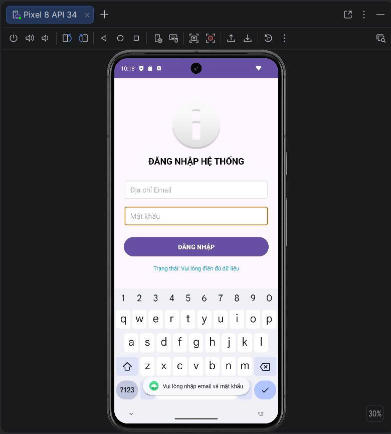
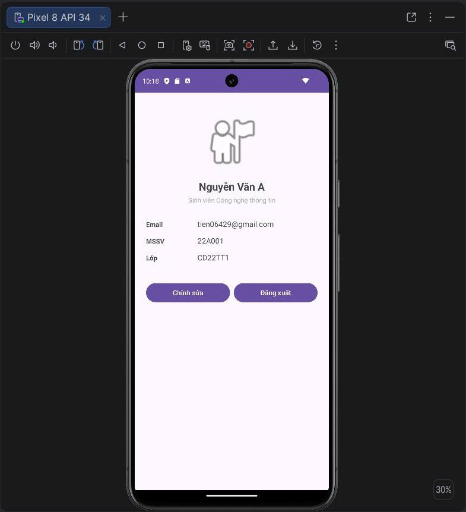

# Lab 2: Thiết kế giao diện XML, ViewBinding và Intent trên Android

## 1. Thông tin sinh viên
- **Họ và tên:** Nguyễn Ngọc Tiến
- **MSSV:** 2500113793

---

## 2. Giới thiệu bài Lab
Ứng dụng gồm 2 màn hình chính:
1. **LoginActivity:** Xử lý đăng nhập, ràng buộc dữ liệu (Validation Email & Mật khẩu $\ge$ 6 ký tự) và truyền dữ liệu qua `Intent`.
2. **ProfileActivity:** Hiển thị thông tin cá nhân và email được nhận từ màn hình đăng nhập, hỗ trợ đăng xuất.

---

## 3. Hình ảnh giao diện (Screenshots)

### Màn hình Đăng nhập (Login)

### Màn hình Hồ sơ (Profile)

---

## 4. Công nghệ sử dụng
- **Language:** Kotlin
- **UI Layout:** ConstraintLayout
- **View Management:** ViewBinding (`viewBinding = true`)